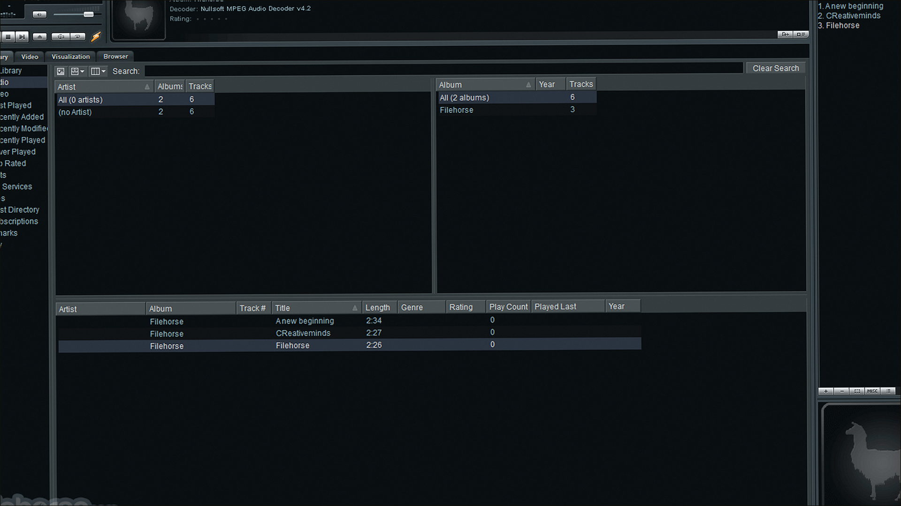
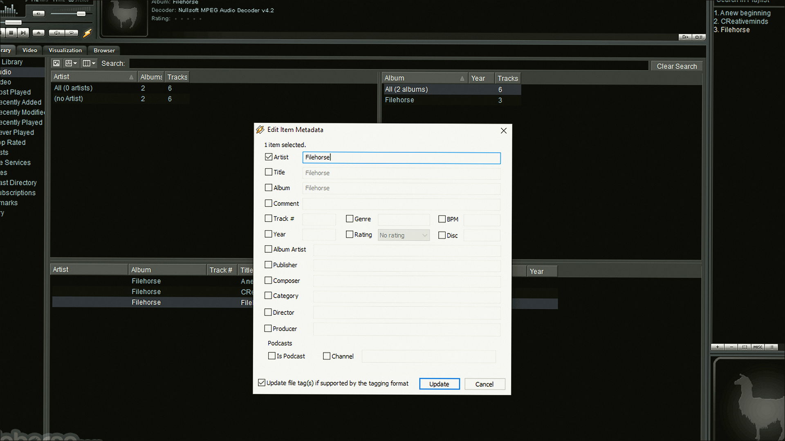
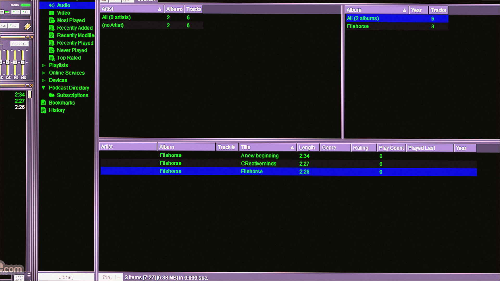

# Windows notes: Winamp Language Pack

**сообщество Winamp (неофициальный сборник)** · 1.4 · 4.8 MB · Audio catalog

[Open card](https://moggydayprogram.com/programs/winamp-language-pack) · [English](https://moggydayprogram.com/en/programs/winamp-language-pack) · [GitHub Pages](https://meshherbalistknow.github.io/winamp-language-pack-windows/?lang=en)

  
  
  

Русификатор для Winamp. Нужен сам плеер отдельно.

Winamp Language Pack on Windows 10/11 x64. 4.8 MB. Requirements, screenshots, MoggyDay Launcher.

Get it from the catalog card, not from this repository.

| Field | Value |
| --- | --- |
| Build | 1.4 |
| OS | Windows 10/11 x64 |
| Pages | https://meshherbalistknow.github.io/winamp-language-pack-windows/ |

- [AIMP](https://moggydayprogram.com/programs/aimp)
- [PotPlayer](https://moggydayprogram.com/programs/potplayer)
